# Architecture

This document describes how Private-C2 works at the module level: what each module does, how they depend on each other, the exact code paths for every major user flow, and which areas are fragile. Every claim is cross-checked against source code.

---

## Module Dependency Diagram

```mermaid
graph TD
    subgraph "Entry Points (cmd/)"
        CMD_SERVER["cmd/server<br/>main.go"]
        CMD_CLIENT["cmd/client<br/>main.go"]
        CMD_IMPLANT["cmd/implant<br/>main.go"]
        CMD_BUILDER["cmd/builder<br/>main.go (stub)"]
    end

    subgraph "Server"
        HTTPAPI["server/api/httpapi<br/>handler.go, auth.go"]
        GRPC_API["server/api/grpc<br/>(stubs, not wired)"]
        MIDDLEWARE["server/api/middleware<br/>(stubs, not wired)"]
        C2_HANDLER["server/c2<br/>handler.go"]
        LISTENERS["server/c2/listener<br/>dns, https, mtls, wireguard"]
        PROFILE["server/c2/profile"]
        CORE_SESSIONS["server/core<br/>sessions.go, events.go"]
        CORE_SECURITY["server/core<br/>security.go"]
        BUILD_PIPELINE["server/build<br/>config, queue, stages"]
        STORE["server/store<br/>db.go"]
        MODELS["server/store/models<br/>models.go, ot.go"]
        REPOS["server/store/repository"]
        CONFIG["server/config<br/>config.go"]
        TELEMETRY["server/telemetry<br/>health.go, metrics.go"]
    end

    subgraph "Implant (library packages)"
        IMP_RUNTIME["implant/runtime<br/>runtime.go, config.go"]
        IMP_SAFETY["implant/safety<br/>safety.go, allowlist.go"]
        IMP_TASK["implant/task<br/>executor.go, registry.go"]
        IMP_TRANSPORT["implant/transport<br/>transport.go, manager.go"]
        IMP_TRANSPORT_IMPL["implant/transport/<br/>mtls, https, dns,<br/>wireguard, pivot"]
        IMP_MODULES["implant/modules<br/>shell, filesystem, process,<br/>network, screenshot, logs"]
        IMP_OT["implant/modules/ot<br/>ot.go + 17 protocols"]
        IMP_EVASION["implant/evasion<br/>stealth, syscalls"]
    end

    subgraph "Shared Libraries (pkg/)"
        PKG_CRYPTO["pkg/crypto<br/>aead, keyexchange,<br/>pki, signing, wipe"]
        PKG_ENVELOPE["pkg/envelope<br/>envelope, framing,<br/>compression"]
        PKG_ENGAGEMENT["pkg/engagement<br/>scope, safeguards"]
        PKG_AUDIT["pkg/audit<br/>logger, export"]
        PKG_PLATFORM["pkg/platform<br/>matrix, validation"]
    end

    subgraph "Definitions"
        PROTO["proto/v1<br/>7 .proto files<br/>(no codegen yet)"]
    end

    %% cmd/server dependencies (verified imports)
    CMD_SERVER --> HTTPAPI
    CMD_SERVER --> C2_HANDLER
    CMD_SERVER --> STORE
    CMD_SERVER --> TELEMETRY

    %% httpapi dependencies (verified imports)
    HTTPAPI --> C2_HANDLER
    HTTPAPI --> MODELS

    %% c2/handler dependencies (verified imports)
    C2_HANDLER --> PKG_ENVELOPE

    %% store dependencies (verified imports)
    STORE --> MODELS

    %% cmd/implant dependencies (verified imports)
    CMD_IMPLANT --> PKG_ENVELOPE

    %% implant library (not wired to cmd/implant)
    IMP_RUNTIME --> IMP_TRANSPORT
    IMP_TRANSPORT --> IMP_TRANSPORT_IMPL
    IMP_SAFETY --> PKG_ENGAGEMENT
    IMP_OT --> PKG_ENGAGEMENT

    %% pkg internal dependencies (verified imports)
    PKG_ENVELOPE --> PKG_CRYPTO

    %% build pipeline (verified imports)
    BUILD_PIPELINE --> PKG_PLATFORM

    %% Designed but not wired (dashed)
    GRPC_API -.-> PROTO
    CORE_SESSIONS -.-> C2_HANDLER
    CONFIG -.-> CMD_SERVER
    IMP_RUNTIME -.-> CMD_IMPLANT
    IMP_SAFETY -.-> CMD_IMPLANT
    IMP_TASK -.-> CMD_IMPLANT

    style GRPC_API fill:#555,stroke:#888,color:#ccc
    style MIDDLEWARE fill:#555,stroke:#888,color:#ccc
    style CONFIG fill:#555,stroke:#888,color:#ccc
    style CMD_BUILDER fill:#555,stroke:#888,color:#ccc
    style CORE_SESSIONS fill:#555,stroke:#888,color:#ccc
```

**Legend**: Grey boxes are designed but not wired into any running code path. Dashed arrows show intended-but-unconnected dependencies.

---

## Module Details

### `cmd/server` (Entry Point)

- **Job**: Start the C2 server process: open database, set up TLS, launch implant listener, HTTP API, and metrics/health server.
- **Inputs**: CLI flags (`--listen`, `--api`, `--metrics-addr`, `--cert`, `--key`, `--ca`, `--db`).
- **Outputs**: Three running servers (TLS socket on `:4444`, HTTP API on `127.0.0.1:8080`, metrics on `:9090`).
- **Touches**: `server/store` (database), `server/c2` (implant handler), `server/api/httpapi` (REST router), `server/telemetry` (Prometheus + health).
- **Note**: Does **not** use `server/config` (env-var loader) or `server/core` (session state machine/event bus). Uses `flag` package with hardcoded defaults instead.

### `cmd/client` (Entry Point)

- **Job**: Interactive operator CLI. Connects to the server's HTTP API to list sessions, submit tasks, and display results.
- **Inputs**: `--server` flag (HTTP API base URL). User types commands at a REPL prompt.
- **Outputs**: Formatted terminal output (ANSI colors).
- **Touches**: `server/api/httpapi` endpoints via `net/http` client. No internal package imports.
- **Note**: All logic (API client, rendering, argument parsing) lives in a single 690-line `main.go`. Does not use `client/console/` or `client/cli/commands/` packages.

### `cmd/implant` (Entry Point)

- **Job**: Beacon-mode implant that connects to the server over TLS, registers, and polls for tasks in a loop.
- **Inputs**: `--server`, `--interval`, `--jitter`, `--ca` flags.
- **Outputs**: Task results sent back to the server.
- **Touches**: `pkg/envelope` (length-prefixed framing only; `ReadFrame`/`WriteFrame`).
- **Note**: Does **not** use any of the structured `implant/` packages (runtime, safety, transport, task, modules, evasion). Implements its own TLS, registration, beacon loop, and task handlers inline.

### `server/c2` (Core C2 Handler)

- **Job**: Manage implant connections. Accept TLS connections, process the registration handshake, run a per-connection message loop (checkins and results), queue/dispatch tasks.
- **Inputs**: `net.Conn` from the TLS listener (passed by `cmd/server`).
- **Outputs**: In-memory session map, task queues, task results.
- **Touches**: `pkg/envelope` (`ReadFrame`/`WriteFrame` for wire framing).
- **Key types**:
  - `ImplantServer` — central state holder: `sessions map[string]*ImplantSession`, `taskQueues map[string][]*Task`, `taskResults map[string]*TaskResult` (all `sync.RWMutex`-protected).
  - `ImplantSession` — per-connection metadata including the raw `net.Conn`.
- **Note**: State is purely in-memory. Nothing is persisted to the database. Session and task structs are duplicated from `cmd/implant` and `server/store/models` with no shared type.

### `server/api/httpapi` (HTTP REST API)

- **Job**: REST endpoints for operators (CLI and web portal). Authentication. Embedded web UI.
- **Inputs**: HTTP requests from operators.
- **Outputs**: JSON responses. Embedded HTML for the web portal at `/`.
- **Touches**: `server/c2` (`ImplantServer` methods: `ListSessions`, `GetSession`, `QueueTask`, `GetResult`), `server/store/models` (GORM queries for beacons, listeners, engagements, payloads, operators, audit, OT).
- **Key functions**:
  - `NewRouter()` — builds the entire HTTP mux (1084-line monolith).
  - `NewAuthManager()` — in-memory token auth.
  - `buildImplant()` — server-side `go build` cross-compilation of `cmd/implant`.
- **Note**: Live session/task data comes from `ImplantServer` (in-memory). All other data (beacons, listeners, engagements, payloads, operators, audit, OT) comes from GORM/database.

### `server/store` (Database Layer)

- **Job**: Open a GORM database (SQLite or PostgreSQL), run auto-migration for all models.
- **Inputs**: `Config{Dialect, DSN}`.
- **Outputs**: `*gorm.DB` instance.
- **Touches**: `server/store/models` (all 19 model structs passed to `AutoMigrate`).

### `server/store/models` (Data Models)

- **Job**: Define the GORM ORM structs for all persistent entities.
- **Key models**:
  - Core (9): `Operator`, `Session`, `Beacon`, `Listener`, `PayloadArtifact`, `Engagement`, `AuditEntry`, `C2Profile`, `Role`.
  - OT/ICS (10): `OTAssetRecord`, `OTCredentialFinding`, `OTVulnFinding`, `OTSegmentationGap`, `OTComplianceFinding`, `OTTopologyEdge`, `OTCaptureSession`, `OTAssessmentReport`, `OTHMIFinding`, `OTWirelessFinding`.
- **Touches**: `github.com/google/uuid` (auto-generated IDs in `Base.BeforeCreate`).

### `server/core` (Session State Machine + Event Bus)

- **Job**: Define session lifecycle states and transitions, provide an in-process pub/sub event bus.
- **`sessions.go`**: `SessionManager` with states `connecting → registering → active → stale → lost → disconnected`. Health check loop promotes active→stale→lost based on configurable thresholds.
- **`events.go`**: `EventBus` with typed events (session connected/disconnected, health change, task queued/completed, kill switch, etc.). Handlers dispatched in goroutines.
- **`security.go`**: Input validation utilities (UUID, name, path traversal, IP, CIDR, port, transport).
- **Touches**: No external imports (self-contained). References `EventBus` from `sessions.go`.
- **Note**: **Not integrated** into the running server. `server/c2/handler.go` manages its own session state independently.

### `server/telemetry` (Metrics + Health)

- **Job**: Prometheus metric registration, health check endpoint.
- **Inputs**: Called by `cmd/server` during init.
- **Outputs**: `/metrics` (Prometheus handler), `/healthz` (JSON health status).
- **Touches**: `github.com/prometheus/client_golang`.
- **Metrics defined**: `privatec2_active_sessions`, `privatec2_active_beacons`, `privatec2_active_listeners`, `privatec2_grpc_requests_total`, `privatec2_tasks_executed_total`, `privatec2_payloads_built_total`, `privatec2_data_exfil_bytes_total`, `privatec2_scope_violations_total`, `privatec2_killswitch_activations_total`.
- **Note**: Metrics are registered but never incremented by the current code paths. The active server code does not call any telemetry update functions.

### `server/build` (Build Pipeline)

- **Job**: Structured implant build pipeline with configuration, job queuing, and build stages.
- **`config.go`**: `BuildConfig` struct with validation against `pkg/platform` support matrix. Generates Go build tags from config (transport, feature, evasion, safemode, debug).
- **`queue/`**: Build job queue and worker pool.
- **`stages/`**: Build stages: configure, compile, obfuscate, postprocess, stager.
- **Touches**: `pkg/platform` (validation).
- **Note**: **Not used** by the running server. The HTTP API's `buildImplant()` in `handler.go` calls `go build` directly, bypassing this pipeline.

### `server/config` (Configuration)

- **Job**: Load server configuration from `PC2_*` environment variables with validated defaults.
- **Env vars**: `PC2_GRPC_ADDR`, `PC2_METRICS_ADDR`, `PC2_DB_DIALECT`, `PC2_DB_DSN`, `PC2_CA_CERT_PATH`, `PC2_SERVER_CERT_PATH`, `PC2_SERVER_KEY_PATH`, `PC2_RATE_LIMIT_RPS`, `PC2_RATE_LIMIT_BURST`, `PC2_SESSION_STALE_THRESHOLD`, `PC2_SESSION_LOST_THRESHOLD`, `PC2_LOG_LEVEL`, `PC2_AUDIT_FILE_PATH`.
- **Note**: **Not imported** by `cmd/server/main.go`. The server uses `flag` package parsing instead.

### `pkg/envelope` (Wire Protocol)

- **Job**: Two layers of wire protocol support.
- **Framing** (`framing.go`): Length-prefixed message framing. 4-byte little-endian uint32 length header + payload. Max 2 GB. Used by both `server/c2/handler.go` and `cmd/implant/main.go`.
- **Signed envelope** (`envelope.go`): `Seal()` compresses (gzip) → encrypts (XChaCha20-Poly1305) → signs (Ed25519). `Open()` verifies → decrypts → decompresses. **Not used** in the current wire path.
- **Touches**: `pkg/crypto` (from `envelope.go` only).

### `pkg/crypto` (Cryptography)

- **Job**: Cryptographic primitives.
- **`aead.go`**: XChaCha20-Poly1305 encryption/decryption with replay detection (SHA-256 digest dedup via `sync.Map`). `CipherContext` holds a 32-byte key.
- **`keyexchange.go`**: X25519 Diffie-Hellman key exchange.
- **`pki.go`**: ECDSA P-384 certificate generation and verification.
- **`signing.go`**: Ed25519 key generation, signing, verification.
- **`wipe.go`**: Secure memory zeroing.
- **Touches**: `golang.org/x/crypto/chacha20poly1305`.
- **Note**: Only used by `pkg/envelope/envelope.go` (the Seal/Open path). Not used by the current implant or server wire protocol.

### `pkg/engagement` (Scope + Safeguards)

- **Job**: Engagement safety enforcement.
- **`scope.go`**: `Scope` struct validates targets against CIDR ranges, hostnames, domain suffixes, and exclusion lists. `TimeWindow` checks engagement start/end times.
- **`safeguards.go`**: `KillSwitch` (per-engagement activation map), `CheckRemoteKillSwitch` (HTTP GET, fail-closed: network error = kill), `DataQuota` (byte-counting limiter).
- **Touches**: `net/http` (for remote kill switch check).
- **Used by**: `implant/safety/safety.go`, `implant/modules/ot/ot.go`.

### `pkg/audit` (Audit Logging)

- **Job**: Append-only audit logging with SHA-256 hash chaining.
- **`logger.go`**: `Logger` computes hash chains: each entry's `EntryHash` = SHA-256 of `{ID, Timestamp, OperatorID, EventType, Action, PreviousHash}`. Writes to pluggable `Writer` interface.
- **`export.go`**: Export audit entries as JSON, CEF, or LEEF formats.
- **Touches**: `github.com/google/uuid`.
- **Note**: The Logger is not wired into the HTTP API server. Audit entries in the database (`AuditEntry` model) are queried directly by the API but are never written through this logger in the current code path.

### `pkg/platform` (Platform Matrix)

- **Job**: Validate OS/arch combinations, transport support, and feature support per platform.
- **Used by**: `server/build/config.go` (build validation).

### `implant/runtime` (Implant Runtime Library)

- **Job**: Structured implant lifecycle: init → register → run loop (beacon/session mode). Kill date checks, remote kill switch, transport failover, jittered sleep.
- **Touches**: `implant/transport` (transport interface + manager).
- **Note**: **Not used** by `cmd/implant/main.go`. The working implant reimplements this logic inline.

### `implant/safety` (Safety Checker Library)

- **Job**: Pre-execution safety validation: kill switch, kill date, time window, scope, data quota. Command allowlist for safe simulation mode.
- **Touches**: `pkg/engagement` (scope, kill switch, time window, data quota).
- **Note**: **Not used** by `cmd/implant/main.go`.

### `implant/task` (Task Execution Library)

- **Job**: Task dispatch with concurrency limits (semaphore), timeouts, and result buffering for beacon mode. Registry pattern for handler functions.
- **Task types defined**: shell, upload, download, ls, ps, ifconfig, screenshot, kill, cat, mkdir, rm, cp, mv, pwd, cd, netstat, portscan, resolve.
- **Note**: **Not used** by `cmd/implant/main.go`, which has its own inline `handleTask` switch statement supporting a subset (shell, ls, pwd, cd, ps, cat, upload, download).

### `implant/transport` (Transport Library)

- **Job**: Transport interface (`Connect`, `Send`, `Recv`, `Close`, `Name`) and failover manager with health scoring, exponential backoff, and priority-based re-promotion.
- **Implementations**: `mtls/`, `https/`, `dns/`, `wireguard/`, `pivot/`.
- **Note**: **Not used** by `cmd/implant/main.go`, which uses `crypto/tls` directly.

### `implant/modules/ot` (OT/ICS Assessment Library)

- **Job**: Read-only OT/ICS assessment with safety interlocks. Pre-flight checks (kill switch, scope, time window, connection limits, safety-critical tags, rate limiting). Watchdog auto-shutdown on server contact loss. 17 industrial protocol clients.
- **Touches**: `pkg/engagement` (scope, kill switch, time window).
- **Protocol clients** (in `protocols/`): Modbus, OPC UA, S7comm, DNP3, BACnet, IEC 104, IEC 61850, EtherNet/IP, PROFINET, FINS, HART, MELSEC, Crimson, PC WORX, MQTT, CoAP.
- **Note**: `isSafetyCritical()` is a stub that always returns `false`.

---

## User Flows

### Flow 1: Operator Login (Web Portal)

| Step | File | Function / Line | What happens |
|------|------|-----------------|--------------|
| 1 | `server/api/httpapi/webui/index.html` | `loginForm.onsubmit` | User enters username + password; JS sends `POST /api/auth/login` with `{username, password}` |
| 2 | `server/api/httpapi/handler.go:55` | `mux.HandleFunc("/api/auth/login", auth.LoginHandler())` | Route is public (no auth middleware) |
| 3 | `server/api/httpapi/auth.go:95-128` | `AuthManager.LoginHandler()` | Decodes `LoginRequest`, calls `authenticate()` |
| 4 | `server/api/httpapi/auth.go:61-69` | `AuthManager.authenticate()` | Looks up bcrypt hash in `am.users` map, compares with `bcrypt.CompareHashAndPassword` |
| 5 | `server/api/httpapi/auth.go:71-83` | `AuthManager.issueToken()` | Generates 32 random bytes → hex-encoded token, stores in `am.tokens` with 12h TTL |
| 6 | `server/api/httpapi/auth.go:127` | response | Returns `{token: "..."}` JSON. Web portal stores token in JS variable for subsequent `Authorization: Bearer <token>` headers |

**Default credentials**: `admin` / `admin` (hardcoded in `auth.go:46-48`, `ensureDefaultUser()`).

### Flow 2: Implant Registration

| Step | File | Function / Line | What happens |
|------|------|-----------------|--------------|
| 1 | `cmd/implant/main.go:237-244` | `connect()` | TLS dial to server with `tls.DialWithDialer`, TLS 1.3 minimum |
| 2 | `cmd/implant/main.go:123-139` | `collectSystemInfo()` | Gathers hostname, username, OS, arch, PID, process name. Generates 16-char hex implant ID |
| 3 | `cmd/implant/main.go:246-270` | `register()` | Marshals `RegisterData` to JSON, wraps in `Message{Type:"register"}`, sends via `envelope.WriteFrame` (4-byte length prefix + JSON) |
| 4 | `cmd/server/main.go:74-89` | accept loop | `tlsListener.Accept()` → `implantServer.HandleConnection(conn)` in goroutine |
| 5 | `server/c2/handler.go:121-148` | `ImplantServer.HandleConnection()` | Reads first frame with `envelope.ReadFrame`, unmarshals `Message`, expects `Type == "register"`, unmarshals `RegisterData` |
| 6 | `server/c2/handler.go:150-170` | session creation | Creates `ImplantSession` with `uuid.New()` ID, stores in `s.sessions` map |
| 7 | `server/c2/handler.go:174-179` | register_ack | Sends `register_ack` message with session ID and interval (hardcoded 5000ms) via `s.sendMessage()` → `envelope.WriteFrame` |
| 8 | `cmd/implant/main.go:258-269` | ack handling | Reads `register_ack`, extracts `SessionID` |

### Flow 3: Task Execution (Shell Command)

| Step | File | Function / Line | What happens |
|------|------|-----------------|--------------|
| 1 | `cmd/client/main.go:143-144` | `case "shell"` | Operator types `shell whoami` in CLI |
| 2 | `cmd/client/main.go:550-609` | `cmdTask()` | Sends `POST /api/sessions/{id}/task` with `{type:"shell", args:"whoami"}` |
| 3 | `server/api/httpapi/handler.go:128-147` | `case "task"` handler | Decodes `TaskRequest`, calls `implantServer.QueueTask(sessionID, "shell", "whoami")` |
| 4 | `server/c2/handler.go:284-303` | `ImplantServer.QueueTask()` | Validates session exists, creates `Task{ID: uuid, Type, Args}`, appends to `s.taskQueues[sessionID]` |
| 5 | `cmd/implant/main.go:356-417` | `beaconLoop()` | On next checkin: sends `Message{Type:"checkin"}`, receives `Message{Type:"tasking"}` with tasks array |
| 6 | `server/c2/handler.go:210-232` | `handleCheckin()` | Updates `LastCheckin`, drains `taskQueues[sessionID]`, sends `TaskingData{Tasks: [...]}` |
| 7 | `cmd/implant/main.go:390-417` | task loop | For each task, calls `handleTask(ctx, task)` |
| 8 | `cmd/implant/main.go:155-164` | `handleTask() case "shell"` | Calls `executeShell()` → `exec.CommandContext("/bin/sh", "-c", "whoami")` (or `cmd /c` on Windows) |
| 9 | `cmd/implant/main.go:393-407` | result send | Builds `ResultData{SessionID, TaskID, Success, Output}`, sends `Message{Type:"result"}` |
| 10 | `server/c2/handler.go:234-260` | `handleResult()` | Stores `TaskResult` in `s.taskResults[taskID]`, sends `result_ack` |
| 11 | `cmd/client/main.go:567-609` | polling | CLI polls `GET /api/tasks/{taskID}` every 500ms until `status == "completed"` or 30s timeout |
| 12 | `server/api/httpapi/handler.go:197-218` | `/api/tasks/{id}` | Calls `implantServer.GetResult(taskID)`. Returns result JSON or `{status:"pending"}` |

### Flow 4: Payload Generation + Download

| Step | File | Function / Line | What happens |
|------|------|-----------------|--------------|
| 1 | `server/api/httpapi/handler.go:499-553` | `POST /api/payloads/generate` | Decodes `PayloadArtifact` from request body, validates `TargetOS` |
| 2 | `server/api/httpapi/handler.go:1023-1084` | `buildImplant()` | Creates temp dir, finds project root by walking up from CWD looking for `go.work` |
| 3 | `server/api/httpapi/handler.go:1050-1056` | `exec.Command("go", "build", ...)` | Runs `go build -ldflags="-s -w" -trimpath -o <tmpdir>/implant ./cmd/implant/...` with `GOOS`, `GOARCH`, `CGO_ENABLED=0` |
| 4 | `server/api/httpapi/handler.go:1063-1068` | binary read | Reads compiled binary from temp dir, computes SHA-256 hash |
| 5 | `server/api/httpapi/handler.go:1070-1083` | database save | Stores `PayloadArtifact` with binary data in `BinaryData` field (GORM create) |
| 6 | `server/api/httpapi/handler.go:582-622` | `GET /api/payloads/{id}/download` | Looks up payload by ID, checks not revoked, serves `BinaryData` as `application/octet-stream` with appropriate filename extension |

### Flow 5: Engagement Creation + Scope Check

| Step | File | Function / Line | What happens |
|------|------|-----------------|--------------|
| 1 | `server/api/httpapi/handler.go:328-364` | `POST /api/engagements` | Decodes `Engagement` model, validates name not empty, `db.Create()` |
| 2 | `server/api/httpapi/handler.go:436-463` | `POST /api/engagements/{id}/scope-check` | Decodes `{target: "..."}`, loads engagement from DB, checks if `target` appears in `eng.ScopeConfig` with `strings.Contains` |
| 3 | `server/api/httpapi/handler.go:416-431` | `POST /api/engagements/{id}/killswitch` | Updates engagement status to `"killed"` in database |

**Note**: The HTTP API scope check uses a simple `strings.Contains` on the raw `ScopeConfig` JSON field. The structured `pkg/engagement/scope.go` (`Scope.Contains`) with proper CIDR/hostname/domain matching is available but not used by this endpoint.

### Flow 6: Audit Log Verification

| Step | File | Function / Line | What happens |
|------|------|-----------------|--------------|
| 1 | `server/api/httpapi/handler.go:814-878` | `GET /api/audit/verify` | Loads all `AuditEntry` records ordered by `created_at ASC` |
| 2 | | hash chain walk | For each entry: verifies `PreviousHash` matches the prior entry's `EntryHash`, then recomputes `EntryHash` as `SHA256(ID + CreatedAt + Action + PreviousHash)` and compares |
| 3 | | response | Returns `{valid: bool, entries: int, broken_at_index: int}` |

**Note**: The hash computation in `handler.go` uses `sha256(id + created_at_rfc3339nano + action + previous_hash)`. The `pkg/audit/logger.go` computes it differently: `sha256(json({id, timestamp, operator_id, event_type, action, previous_hash}))`. These two implementations are **incompatible** if both are ever used on the same data.

### Flow 7: Implant Beacon Loop (Steady State)

| Step | File | Function / Line | What happens |
|------|------|-----------------|--------------|
| 1 | `cmd/implant/main.go:356-359` | `beaconLoop()` | Calls `sleepWithJitter(interval, jitter)` — actual sleep = `interval ± (interval * jitter)` |
| 2 | `cmd/implant/main.go:365-369` | checkin send | Marshals `CheckinData{SessionID}`, sends `Message{Type:"checkin"}` via `envelope.WriteFrame` |
| 3 | `cmd/implant/main.go:371-387` | tasking recv | Reads frame, expects `Message{Type:"tasking"}`, unmarshals `TaskingData{Tasks}` |
| 4 | `cmd/implant/main.go:390-417` | execute tasks | Iterates tasks, calls `handleTask()` for each. Sends `Message{Type:"result"}` per task, waits for `result_ack` |
| 5 | | loop | Returns to step 1 |

**Reconnection**: If any read/write fails, `beaconLoop` returns an error. The outer loop in `main()` (lines 305-353) reconnects with exponential backoff (1s base, 60s max), re-registers, and enters a new beacon loop.

---

## Fragile Areas

### 1. Duplicated Wire Protocol Types

**Files**: `server/c2/handler.go`, `cmd/implant/main.go`, `cmd/client/main.go`

The `Message`, `RegisterData`, `CheckinData`, `TaskingData`, `ResultData` structs are defined independently in three places with no shared type package. Changing a field name or adding a field in one place without updating the others will silently break the wire protocol — JSON unmarshaling will skip unknown fields without error.

**Risk**: Any wire protocol change requires coordinated edits across all three files.

### 2. In-Memory Session/Task State

**File**: `server/c2/handler.go` (lines 103-108)

All live session data, task queues, and task results are stored in `ImplantServer` maps protected by `sync.RWMutex`. This state is lost on server restart. A submitted task whose result hasn't been polled yet will vanish if the server restarts.

**Risk**: Server restart = total state loss. No way to recover pending tasks or reconnect sessions.

### 3. Two Incompatible Audit Hash Implementations

**Files**: `pkg/audit/logger.go:96-114` and `server/api/httpapi/handler.go:844-874`

The audit logger in `pkg/audit` computes hashes from a JSON struct `{id, timestamp, operator_id, event_type, action, previous_hash}`. The verification endpoint in `handler.go` computes hashes as `sha256(id_bytes + created_at_rfc3339nano_bytes + action_bytes + previous_hash_bytes)`. If audit entries are ever written by one implementation and verified by the other, the chain will fail validation.

**Risk**: Wiring in `pkg/audit/logger.go` to write entries will break the existing verification endpoint, or vice versa.

### 4. handler.go Monolith

**File**: `server/api/httpapi/handler.go` (1084 lines)

All REST endpoints are defined as inline closures within a single `NewRouter()` function. Each closure captures `implantServer` and `db` from the function's scope. Adding, modifying, or debugging any endpoint requires navigating this single massive function.

**Risk**: Merge conflicts are likely when multiple changes touch different endpoints. Route registration bugs (e.g., overlapping paths) are hard to spot.

### 5. `cmd/implant` vs `implant/` Package Divergence

**Files**: `cmd/implant/main.go` vs `implant/runtime/`, `implant/safety/`, `implant/task/`, `implant/transport/`

The working implant (`cmd/implant/main.go`) and the library packages (`implant/`) solve the same problems independently. The library packages are more complete (safety checks, transport failover, task registry, concurrency limits) but the running implant doesn't use them. Changes to the library packages have zero effect on the deployed implant.

**Risk**: Fixing a bug or adding a feature in the `implant/` library will not affect the actual implant binary. Work done in `cmd/implant/main.go` will not benefit from the safety checks, allowlisting, or transport failover in the library.

### 6. buildImplant() Project Root Discovery

**File**: `server/api/httpapi/handler.go:1037-1048`

The payload generation function finds the project root by walking up from the executable path looking for `go.work`, then falling back to walking up from CWD. In a Docker container or when run from a non-standard location, this heuristic may fail silently and produce a build error.

**Risk**: Payload generation will break if the server runs from a directory that can't resolve to the project root, or if the source tree isn't present on the server host.

### 7. Simple String-Based Scope Check in HTTP API

**File**: `server/api/httpapi/handler.go:456`

The `/api/engagements/{id}/scope-check` endpoint checks scope with `strings.Contains(eng.ScopeConfig, body.Target)`. A target like `"10"` would match a scope config containing `"10.0.0.0/8"`, or any IP/hostname containing `"10"` as a substring.

**Risk**: False positives in scope validation. The structured `pkg/engagement/scope.go` has proper CIDR parsing and hostname matching but is not used here.

### 8. Embedded Web Portal

**File**: `server/api/httpapi/webui/index.html` (1732 lines)

The entire web portal (HTML + CSS + JavaScript) is in one embedded file. It calls every API endpoint and manages frontend state in vanilla JS. Any change to an API response shape requires finding and updating the corresponding JS rendering code within this single file.

**Risk**: API response changes require manual updates to the embedded HTML. No build step or type checking catches mismatches between API and frontend.

### 9. Metrics Registered but Never Updated

**File**: `server/telemetry/metrics.go`

Ten Prometheus metrics are registered at startup but the running server code never calls any `Inc()`, `Set()`, or `Observe()` on them. Connecting Prometheus scraping will show all metrics at their zero values.

**Risk**: Operators relying on metrics dashboards will see no data. Adding metric updates requires touching many files (`handler.go`, `c2/handler.go`, etc.) to instrument each path.

---

## Open Questions

- **Audit write path**: No code currently writes `AuditEntry` records to the database. The `pkg/audit/logger.go` is available but not wired in, and the two hash implementations are incompatible. How should audit entries be produced?
- **Session persistence**: The `server/store/models.Session` GORM model exists but `server/c2/handler.go` never writes sessions to the database. Should live sessions be persisted to the database on creation/checkin?
- **gRPC vs REST**: The `server/api/grpc/` stubs, `proto/v1/` definitions, `server/api/middleware/` stubs, and `server/core/` session manager all appear designed for a gRPC server path that was never connected. Will this path replace or coexist with the current HTTP API?
- **OT safety-critical stub**: `implant/modules/ot/ot.go:313-318` `isSafetyCritical()` always returns `false`. How should safety-critical device determination work in practice (asset database lookup, tag matching, etc.)?
- **Metric instrumentation**: The 10 Prometheus metrics are defined but never updated. Which code paths should increment each metric?
